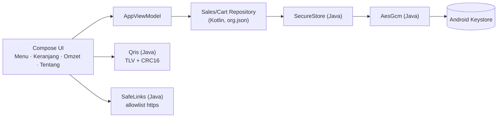

<div align="center">

# 🍜 Kasir Mie Ayam Maju Lancar

**Aplikasi kasir Android yang cepat, rapi, dan aman — 100% offline.**
Menu · Keranjang · QRIS Dinamis · Tunai · Omzet

[](https://github.com/BagasExpoit/Majulancar/actions/workflows/android-release.yml)
[](https://github.com/BagasExpoit/Majulancar/releases/latest)


[⬇️ Unduh APK](https://github.com/BagasExpoit/Majulancar/releases/latest) ·
[✨ Fitur](#-fitur) ·
[🔒 Keamanan](#-keamanan) ·
[🛠️ Build](#️-build--rilis) ·
[🧱 Struktur](#-struktur-proyek)

</div>

---

## 📖 Tentang

Versi **Android native** dari situs kasir `majulancar.biz.id`, ditulis ulang dengan **Kotlin + Java** dan **Jetpack Compose**. Dirancang untuk dipakai langsung di warung: buka aplikasi, pilih menu, terima pembayaran, lihat omzet.

- 🚫 **Tanpa login dan tanpa captcha** — langsung dipakai.
- 📴 **Tanpa izin internet** — tidak ada data yang bisa keluar dari perangkat.
- 🔐 **Data terenkripsi** di penyimpanan HP (AES-256-GCM + Android Keystore).

---

## ✨ Fitur

Navigasi memakai *bottom bar* dengan 4 tab. Tombol 🌙/☀️ di pojok kanan atas mengganti tema gelap/terang (pilihan diingat; sebelum dipilih, tema mengikuti sistem).

| Tab | Yang bisa dilakukan |
|---|---|
| 🍜 **Menu** | Filter kategori, atur jumlah, tambah ke keranjang, bar ringkasan keranjang di bawah layar, status **Buka/Tutup** real-time |
| 🛒 **Keranjang** | Ubah jumlah, hapus item, kosongkan (dengan konfirmasi), total otomatis, badge jumlah item di tab |
| 💳 **Pembayaran** | **QRIS dinamis** (nominal sudah tertanam, pembeli tinggal scan) atau **Tunai** dengan nominal cepat & kembalian |
| 📊 **Omzet** | Total & hari ini, rincian QRIS vs Tunai, riwayat 100 transaksi terbaru, reset dengan konfirmasi |
| ℹ️ **Tentang** | Lokasi (Maps), kontak WhatsApp & Telegram, developer (Facebook, Instagram), ringkasan keamanan |

### 📱 QRIS Dinamis

Payload QRIS statis toko diubah menjadi dinamis sesuai standar EMV: tag `01` → `12`, tag `54` (nominal) disisipkan, dan CRC16-CCITT dihitung ulang.

- Payload di-*parse* sebagai TLV dan **divalidasi dulu** (struktur, ASCII, CRC) sebelum diubah.
- Payload yang tidak valid **tidak pernah dimodifikasi** — aplikasi jatuh kembali ke QR statis dan memberi tahu kasir.
- Hasilnya dicocokkan dengan implementasi TypeScript situs web asli lewat unit test (*golden vector*).

---

## 🔒 Keamanan

| Lapisan | Penerapan |
|---|---|
| **Jaringan** | Manifest **tanpa `<uses-permission>`** sama sekali, cleartext dilarang |
| **Data diam** | Omzet & keranjang dienkripsi **AES-256-GCM**; kunci di **Android Keystore** (StrongBox bila tersedia); nama berkas ikut diautentikasi (AAD) sehingga blob tidak bisa ditukar antarberkas |
| **Integritas** | Harga **selalu dibaca dari katalog**, bukan dari data keranjang; total dihitung ulang saat checkout |
| **Ketahanan** | Penulisan atomik; bila riwayat gagal dimuat, penulisan dinonaktifkan agar data lama tidak tertimpa; data rusak **dikarantina**, bukan dihapus |
| **Layar** | `FLAG_SECURE` (anti screenshot, perekam layar, dan thumbnail *Recent apps*), termasuk dialog pembayaran; proteksi tapjacking |
| **Backup** | `allowBackup=false` + `dataExtractionRules` mengecualikan semua data dari cloud backup & device transfer |
| **Tautan** | Hanya `https` ke daftar situs yang diizinkan (`SafeLinks`), tanpa userinfo dan port non-standar |
| **Rilis** | R8 (minify + shrink), log `v/d/i` dibuang, metadata dependensi tidak disertakan di APK/AAB |

> [!WARNING]
> Karena halaman login dihapus, **siapa pun yang memegang HP dalam keadaan terbuka bisa melihat omzet.** Aktifkan kunci layar di HP kasir.

---

## 🧭 Arsitektur singkat



Kotlin dipakai untuk UI & logika aplikasi; Java dipakai untuk inti keamanan (enkripsi, QRIS, allowlist) agar bisa diuji murni di JVM.

---

## 🧱 Struktur proyek

```text
.
├── .github/workflows/android-release.yml   # CI: test → build → tanda tangan → rilis
├── scripts/generate-keystore.sh            # buat keystore rilis (sekali)
├── app/
│   ├── build.gradle.kts
│   ├── proguard-rules.pro
│   └── src/
│       ├── main/
│       │   ├── java/.../core/              # Java: Qris, AesGcm, SecureStore, SafeLinks
│       │   ├── kotlin/.../                 # Kotlin: UI (Compose), ViewModel, data
│       │   │   ├── data/                   #   Models, Catalog (menu & info toko), Persistence
│       │   │   └── ui/                     #   AppNav, screens, components, theme
│       │   └── res/                        # ikon adaptif, tema, aturan backup & jaringan
│       └── test/java/.../core/             # JUnit: Qris, AesGcm, SafeLinks (13 test)
├── build.gradle.kts · settings.gradle.kts · gradle.properties
└── README.md
```

---

## 🧰 Teknologi

| | |
|---|---|
| Bahasa | Kotlin 2.0.21 · Java 17 |
| UI | Jetpack Compose (BOM 2024.10.01) · Material 3 · Navigation Compose 2.8.4 |
| QR | ZXing `core` 3.5.3 (digambar lokal, tanpa internet) |
| Build | Android Gradle Plugin 8.7.3 · Gradle 8.10.2 · `compileSdk`/`targetSdk` 35 · `minSdk` 26 |
| CI/CD | GitHub Actions (JDK 17 Temurin) |

## ⚠️ Catatan jujur

- Aplikasi ini **belum diuji menyeluruh di banyak perangkat**. Sebelum dipakai berjualan, uji pembayaran Tunai dan QRIS, dan pastikan nominal QRIS terisi otomatis di aplikasi e-wallet Anda.
- Logika inti (QRIS, enkripsi, allowlist tautan) diuji otomatis; **tampilan Compose belum punya UI test**.
- Riwayat omzet tersimpan **hanya di perangkat** dan tidak ikut backup. Menghapus data aplikasi atau mencopot pemasangan akan menghapus omzet.

---

## 👨‍💻 Developer

- Facebook — **bagas orcarius**
- Instagram — **bagas_samuji74**

<div align="center">

© Mie Ayam Maju Lancar Mas Tri · Jl. Babakan Leuwikopo, Depan Polsek Dramaga

</div>
